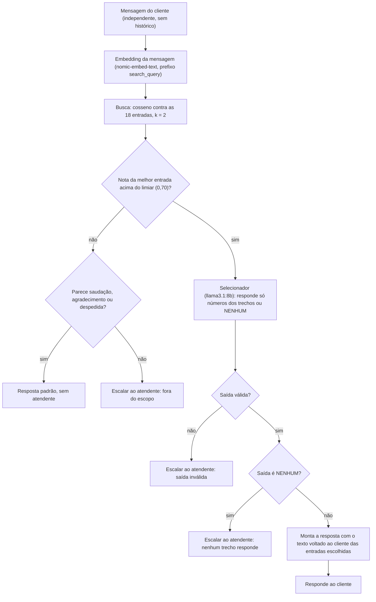

# Assistente de triagem de suporte técnico (Ollama + RAG)

Projeto de lógica para o teste técnico da RabbITech. O assistente recebe a mensagem de um cliente e decide entre **responder automaticamente** e **escalar para um atendente humano**, usando busca por similaridade sobre o `faq_interno.md` (18 entradas). O pipeline é local: modelo via Ollama, sem chamadas a APIs externas.

O documento do desafio (até 4 páginas) está em `docs/`. Os resultados completos dos testes estão em `docs/anexo_detalhado.md`.

## Fluxograma



Ao escalar, o assistente encaminha a mensagem, o motivo, a nota e os trechos recuperados.

## Scripts

Os dois scripts calculam a similaridade (cosseno) entre **uma mensagem** e as 18 entradas do FAQ. Para testar outra mensagem, edite a variável `query`. Eles **não** usam o llama3.1.

| Arquivo | O que faz | Como as entradas são embutidas | Saída |
|---|---|---|---|
| `src/Tentaiv.py` | **Configuração final.** Compara a mensagem com as entradas e classifica o resultado contra o limiar fixo de 0,7. | Texto da pergunta seguido do texto da resposta (sem rótulos), com o prefixo `search_document: `. A consulta usa o prefixo `search_query:` (sem espaço depois dos dois pontos). | Um rótulo (`Responde`, `Não Responde`, `Falso positivo` ou `Falso negativo`) e as duas melhores entradas com a nota em quatro casas. |
| `src/Teste.py` | **Variante de teste: só a pergunta.** Mostra como as notas mudam quando a resposta não entra no texto embutido. Foi usada para comparar com a configuração final na mensagem 5. | Só `Pergunta: <texto da pergunta>`, com o prefixo `search_document: `. A consulta usa `search_query: ` seguido de um caractere de tabulação. | As 18 notas em ordem decrescente, sem limiar nem rótulo. |

Detalhes de uso:

- **`Tentaiv.py`:** a variável `resp` diz o que era esperado para a mensagem. Com `resp = "responde"`, o script imprime `Responde` ou `Falso negativo`. Com qualquer outro valor (o padrão no arquivo é `"respond"`), imprime `Não Responde` ou `Falso positivo`. O bloco entre aspas triplas, se for descomentado, imprime as 18 notas.
- **Mensagem de cada arquivo:** nos arquivos enviados, `query` está com a mensagem 6 ("como fazer requisições na api?").
- **As notas dos dois scripts não são comparáveis entre si** sem levar em conta a diferença de formato do texto embutido. O caractere de tabulação em `Teste_1.py` e o espaço depois do prefixo da consulta também diferem entre os arquivos.
- **O selecionador (llama3.1:8b) não tem script:** foi testado à mão no terminal, com `ollama run llama3.1:8b --verbose`. Os prompts e as saídas estão em `tests/`.

## Como reproduzir

```
ollama pull nomic-embed-text
ollama pull llama3.1:8b
pip install numpy ollama
python src/Tentaiv_1.py
```

O Ollama precisa estar em execução. Para o selecionador, use `ollama run llama3.1:8b --verbose` e cole o prompt com os dois trechos numerados.

## Conjunto de teste (16 mensagens)

| # | Mensagem | Ação esperada |
|---|---|---|
| 1 | como baixo aplicativo pro celular | responder |
| 2 | como adiciono um usuário no plano pro | responder |
| 3 | como redefino a senha se o link expirou | responder |
| 4 | a api tem limite de x requisições? | ressalva (depende do plano) |
| 5 | minha assinatura ta cancelada, como exporto os dados | ressalva (depende de há quanto tempo cancelou) |
| 6 | como fazer requisições na api | escalar |
| 7 | como configurar a webhook | ressalva (cobertura parcial) |
| 8 | como vejo o status do site | ressalva (cobertura parcial) |
| 9 | posso ver quantos usuarios tenho cadastrado | escalar |
| 10 | como ver quem é o admin do plano | escalar |
| 11 | minha api ta errada | escalar |
| 12 | meu plano n funsiona | escalar |
| 13 | não tenho fatura | ressalva (duas leituras possíveis) |
| 14 | não entendi como faiz issco | escalar |
| 15 | como peço reembolso do plano que me inscrevi | escalar |
| 16 | como faco pra entrar no plano pro? e como faço para baixar o aplicativo mobile? | responder as duas perguntas |

No protótipo, a saída do selecionador é binária: os casos de cobertura parcial ("ressalva") escalam.

## Estrutura do repositório

```
README.md                          este arquivo
docs/                              documento do desafio (PDF) e anexo_detalhado.md
src/Tentaiv.py                   configuração final (pergunta + resposta)
src/Teste.py                     variante só com a pergunta
tests/notas.txt                  notas das 16 mensagens e de "bom dia" (Tentaiv_1.py)
tests/testar_e_responder.txt     notas da mensagem 5 só com a pergunta (Teste_1.py)
                                   e saídas do selecionador para as mensagens 3 e 5
tests/                             prompts e saídas do selecionador nas demais mensagens
```

## Ambiente e medidas

- Notebook com Intel Core i5-13420H, 16 GB de RAM, sem GPU dedicada, Windows 11; Ollama 0.40.16; `llama3.1:8b` (contexto de 4096 tokens, 100% na CPU) e `nomic-embed-text`.

| Medida | Valor |
|---|---|
| Geração do llama3.1:8b na CPU | cerca de 7 a 8 tokens por segundo |
| Processamento de tokens novos do prompt | cerca de 24 tokens por segundo |
| Selecionador, saída de 5 tokens | 5,5 a 7,5 s com cache do prefixo; cerca de 10 s sem |
| Carregamento a frio do modelo | cerca de 15 s a mais |
| Geração livre de resposta | 4 a 15 s (curta) e 29 a 34 s (longa) |

## Limitações

- 16 mensagens de teste, uma execução por caso; o limiar de 0,70 é provisório e foi escolhido no mesmo conjunto em que é avaliado.
- A mensagem 6 passa do limiar (0,7838) e depende do selecionador, que a barrou em uma execução e a aceitou em outra.
- A etapa de embedding da mensagem e a concorrência não foram medidas.
- A lista de frases de saudação e o limiar de conversa não foram definidos nem testados; a mensagem mista ("bom dia, como cancelo o plano") foi medida uma vez (0,7110).
- As notas dependem do formato do texto embutido: ao mudá-lo, o limiar deve ser refeito.

## Observação sobre os dados

Confirme se o `faq_interno.md` pode ser publicado em um repositório público antes de incluí-lo.
